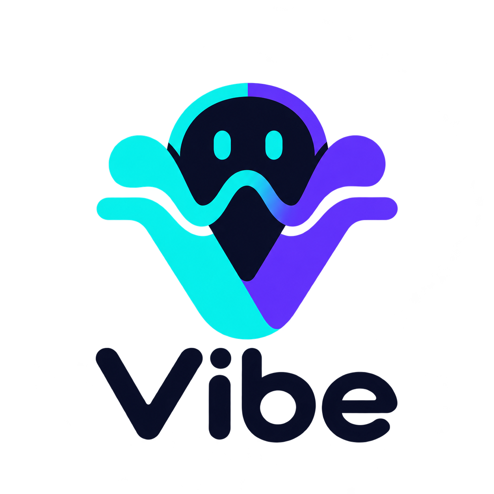

# Vibe

<picture>
  <source media="(prefers-color-scheme: dark)" srcset="assets/brand/vibe-logo-dark.png">
  
</picture>

Vibe 是基于 M5Stack StopWatch 的蓝牙语音输入与 AI 额度面板，目前支持 Codex 与 X 共享周额度，后续计划接入 Grokbot 宠物。

当前版本 **0.1**，基于官方固件逐项扩展，保留原有应用与 iPhone Agent。

默认圆屏显示眼睛、时钟与额度：左右整圈分别表示 Codex 周剩余和 X 共享周剩余，眼睛下方短弧表示 Codex 五小时剩余。轻触打开整屏额度页，左右滑动切换三项，轻触或十五秒无操作返回；录音开始立即返回。未知值显示 `--`，缓存或过期数据标为 `Cached`。旧版面板与主题已移除。

BLE 语音与 X 共享周额度已通过真机验证；0.1 的下弧布局与详情页交互仍待真机回归。Grokbot 宠物数据和 Codex 桌面实时等待确认状态尚未接通，当前眼睛为本地状态动画。蓝牙名称为 `Vibe-*`，兼容旧 `M5Codex-*`。

## 使用与开发

Windows Bridge：`./scripts/start-vibe.ps1 run`。原命令 `start-vibecoding.ps1` 保留为兼容入口。微信输入法选择 `CABLE Output`，按住说话快捷键为 `Ctrl+Win`；Windows 默认播放设备选择实际扬声器或耳机。

```powershell
uv venv --python 3.12 windows_bridge/.venv
uv pip install --python windows_bridge/.venv/Scripts/python.exe -e "windows_bridge[dev]"
./scripts/start-vibe.ps1 init
./scripts/start-vibe.ps1 doctor
./scripts/start-vibe.ps1 run
```

固件构建入口使用本地 `.tools/esp-idf` 与 `.tools/espressif`。安装 ESP-IDF v5.5.4 后，通过 `python fetch_repos.py` 获取项目依赖，再运行：

```powershell
./scripts/build-firmware.ps1 reconfigure
./scripts/build-firmware.ps1 build
windows_bridge/.venv/Scripts/python.exe -m pytest windows_bridge/tests -q
```

使用 ESP-IDF v5.5.4、LVGL v9.5.0；依赖通过 `python fetch_repos.py` 获取。本项目保留官方应用、iPhone Agent、双 OTA 分区与图片存储布局。烧录须使用验证备份和分区的 `scripts/flash-app.ps1`。

- [当前产品与验收说明](docs/vibe.md)
- [LOGO 源图、提示词与资源转换](assets/brand/README.md)
- [Windows Bridge](windows_bridge/README.md)
- [iPhone Agent 移植说明](docs/iphone-agent.md)

版本由根目录 `version.txt` 设置，设备版本显示直接读取固件描述；Bridge 版本在 `windows_bridge/m5vibe/__init__.py`，CLI 可用 `--version` 查询。

基础为 [M5Stack 官方出厂固件](https://github.com/m5stack/M5StopWatch-UserDemo)，第二项功能源自 [M5stopwatch-vibecoding](https://github.com/liptoxli/M5stopwatch-vibecoding)。来源和版本见项目说明。

第三方版本与许可证见 [来源说明](docs/third-party/README.md)。
