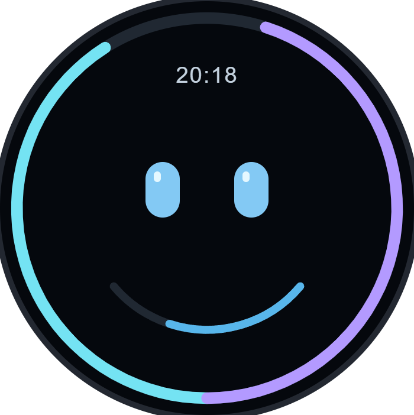
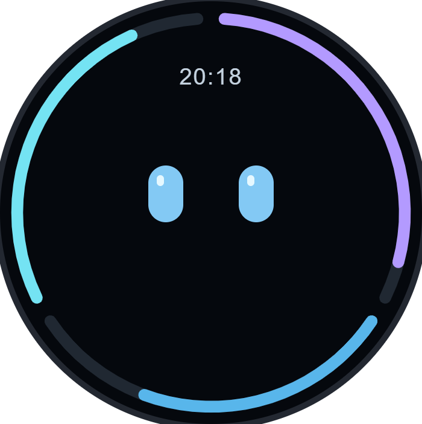
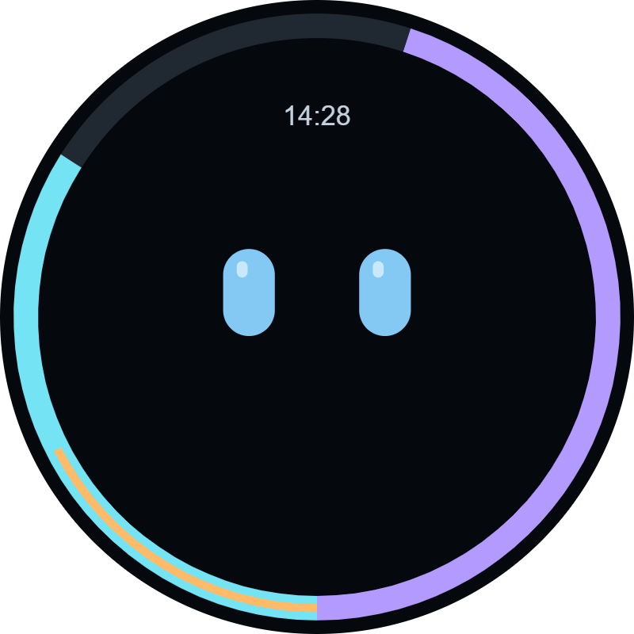

# Vibe 设计归档

本页保留已淘汰的方案，均不是当前固件界面。图片截取自原始交互预览，额度与时间均为示例，不是设备实拍。

当前版本见 [项目首页](../../README.md#当前界面)。

## 下弧副表盘



周额度占左右外圈，五小时额度放在眼睛下方的独立短弧。曾试用，现由同轨双线替代。[原始预览](round-quota.html)

## 三段外圈



把三项额度分配到互相独立的三段外圈，未采用。[原始预览](round-quota.html)

## 宽轨叠线



青色宽轨表示周额度，橙色细线叠在中间表示五小时额度，未采用。[原始预览](shared-ring.html)

## 图片生成

当前预览依据 `main/apps/app_codex/view/vibe.cpp` 的几何和颜色还原，历史截图从此目录中的原始预览捕获。复现：

```powershell
uv run --with playwright --python 3.12 python scripts/render-ui-previews.py
```

需要本机安装 Microsoft Edge。当前预览源为 `current.html`；生成脚本不读取真实额度、设备状态或本机配置。
